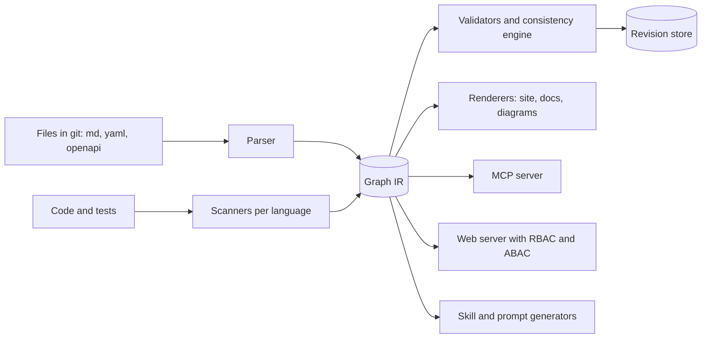

# OxiSpec: design for an agent-first spec engine

Name: **OxiSpec** (decided), hosted on GitHub. Inspired by [OpenSpec](https://github.com/Fission-AI/OpenSpec) (MIT). If we copy any prompts or code from it, we keep its license notice.

## 1. What we keep from OpenSpec, and what changes

| OpenSpec idea | Keep? | In OxiSpec |
|---|---|---|
| Markdown specs with Requirement and Scenario | Keep | Same human format, plus stable IDs and typed links |
| Delta specs merged on archive | Keep | A *change set* is a first-class object with history |
| Workflow as a YAML schema (artifact DAG) | Keep | Generalized to any artifact type, not only proposal/specs/design/tasks |
| One adapter file per AI tool | Keep | Two adapter axes: agent clients and LLM providers |
| `--json` CLI for agents | Keep | Plus an MCP server as the main agent interface |
| Only current state plus an archive folder | **Replace** | Full revision history of the whole graph, with time travel and rollback |
| Documents are separate files | **Replace** | Documents are nodes in a graph. Links are typed and checked |
| Structural validation only | **Replace** | Structural, formal and semantic consistency checking (section 20) |
| One fixed feature set | **Replace** | Opt-in modules chosen at `oxispec init` (section 3) |
| Single-user CLI | **Extend** | Hosted server with RBAC and ABAC for web and MCP |

## 2. Core idea

Everything is a **node** with a stable ID. Nodes are connected by **typed edges**. Files in git are the authoring format. Every change produces an immutable **revision** of the whole graph.



The graph is an intermediate representation (IR). Everything else reads it. That keeps the engine small: parsers write the IR, and every other part is a reader.

## 3. Modules and project setup

A team should adopt only what it needs. OxiSpec is split into **modules**. The core is always on. Everything else is opt-in at `oxispec init` and can be added or removed later.

| Module | Adds | Needs |
|---|---|---|
| `core` (always) | Nodes, links, IDs, revisions, history, structural checks, CLI | none |
| `specs` | Requirements and scenarios, change sets | core |
| `tests` | Test cases, language scanners, test result import, coverage, suspect links | specs |
| `adrs` | ADR nodes, status, supersede links | core |
| `decisions` | Lightweight decision log | core |
| `standards` | Code standards with linter bindings | core |
| `api` | OpenAPI and AsyncAPI import, operation nodes | core |
| `diagrams` | Mermaid, PlantUML, D2 nodes and renderers | core |
| `architecture` | C4 model (context, container, component, dynamic) and deployment model, views, architecture rules, importers | core |
| `statemachines` | State machine DSL, checks, generated tests | specs |
| `consistency` | Claims, solver, optional natural language layer | specs |
| `releases` | Release manifests, gates, notes | core |
| `ci` | `oxispec ci`: graph diff, impact analysis, merge request reports and comments, index snapshots | core |
| `agents` | Skills and rules for AI clients, per-agent overlays | core |
| `mcp` | MCP server | core |
| `server` | Hosted web app, RBAC and ABAC, audit log | core |

**Presets** give a quick start:

| Preset | Modules |
|---|---|
| `minimal` | core, specs |
| `specs-tests` | core, specs, tests |
| `docs` | core, specs, adrs, decisions, diagrams, architecture |
| `standard` | specs-tests plus adrs, decisions, standards, architecture, ci, agents, mcp |
| `full` | everything |

**CLI:**

```bash
oxispec init                          # interactive checklist, with a preset as the starting point
oxispec init --preset specs-tests     # non-interactive
oxispec init --preset minimal --with adrs,diagrams --without agents
oxispec init --topology monorepo-domains    # sets scopes, ID scheme, CI and storage defaults (section 13)
oxispec modules list                  # enabled, available, and what each needs
oxispec modules add tests             # adds templates, scanners, skills; asks for the language
oxispec modules remove adrs           # see rules below
```

The choice is stored in `.oxispec/config.yaml`:

```yaml
modules: [core, specs, tests, adrs]
languages: [go, node]
agents: [claude, cursor]
storage: {profile: solo}      # see section 9
```

**Rules**
- **Dependencies are resolved for you.** Adding `tests` also enables `specs` and says so.
- **Nothing is generated for a disabled module.** Templates, folders, skills, CLI commands, validators and MCP tools exist only for enabled modules. This also keeps the agent's context small, because it only sees the skills that apply.
- **Removing a module never deletes data.** Existing nodes stay in the graph and in history. They become read-only and are skipped by checks. A link from an enabled node to a disabled type shows as a warning, not an error. Re-enabling restores everything.
- **Adding a module later is safe.** `oxispec modules add adrs` creates the folder and template. It can also offer to import existing ADR files with `oxispec import`.
- **Per-directory scope.** In a monorepo, a subfolder can override the module list (for example `services/billing` uses `specs` and `tests` only, while the platform folder uses everything).
- **Plugin interface.** A module is a bundle of node types, edge types, validators, templates, skills, commands and renderers. Built-in modules use the same interface that third-party modules will use later.

## 4. Artifact types and IDs

| Type | ID example | Format | Notes |
|---|---|---|---|
| Requirement | `REQ-AUTH-0012` | Markdown, scenarios, optional `claims` block | Scenario IDs are children: `REQ-AUTH-0012.S1` |
| ADR | `ADR-0007` | MADR markdown | Status: proposed, accepted, superseded |
| Decision log entry | `DEC-2026-0153` | One YAML record: date, decision, one-line context, owner | Cheap. Can be promoted to an ADR |
| Test case | `TC-AUTH-0031` | YAML or markdown: steps, data, level, automated yes/no | Verifies a scenario |
| Code standard | `STD-GO-004` | Markdown rule plus an `enforce:` binding to a linter rule | Standards become checkable |
| API spec | `API-ORDERS` | OpenAPI or AsyncAPI file. Each operation becomes a child node | `API-ORDERS#createOrder` |
| State machine | `SM-ORDER` | YAML DSL (section 19) | Renders to a diagram, generates tests |
| C4 element | `C4-orders-api` | YAML model: person, system, container, component, relationship | Views are generated from the model |
| Deployment node | `DEP-prod-eks` | YAML model: environment, node, infrastructure, container instance | Deployment views and drift checks |
| Diagram | `DGM-0004` | Mermaid, PlantUML or D2 source | Linked to the node it describes |
| Glossary term | `TERM-session` | YAML | Feeds consistency checks |
| Change set | `CHG-0099` | Proposal, delta, tasks | Like an OpenSpec change |

**ID rules:** IDs are immutable, never reused, and independent of file paths. Renaming a file keeps the ID. A content hash tracks each node version.

Example file:

````markdown
---
id: REQ-AUTH-0012
type: requirement
status: accepted
owner: team-identity
links:
  decided-by: [ADR-0007]
  governed-by: [STD-GO-004]
---
### Requirement: Admin session timeout
The system MUST expire admin sessions after 15 minutes of inactivity.

#### Scenario: Idle admin  {#S1}
- **WHEN** an admin is inactive for 15 minutes
- **THEN** the session is invalidated

```claims
for role = admin: session.idle_timeout <= 15m
```
````

## 5. Links and trace IDs

Edge types: `satisfies`, `verifies` (test to scenario), `implements` (code to requirement), `decided-by`, `supersedes`, `refines`, `governed-by` (standard), `describes` (diagram), `overrides`, `conflicts-with`, `depends-on`.

**Trace IDs in code and tests.** Scanners read short annotations:

```go
// spec: REQ-AUTH-0012
func ExpireAdminSession(...) {}

func TestIdleAdmin(t *testing.T) { // verifies: REQ-AUTH-0012.S1
```

```rust
/// spec: REQ-AUTH-0012
fn expire_admin_session() {}
```

```ts
it('invalidates idle admin sessions [REQ-AUTH-0012.S1]', () => {})
```

Also: commit trailers (`Spec: CHG-0099`), PR descriptions, and an OpenTelemetry span attribute `spec.id` so a production trace points back to the requirement.

**Suspect links** (borrowed from requirements tools such as DOORS). Each link records the content hash of both ends when a person confirmed it. If either end changes, the link becomes *suspect* until someone re-confirms it. For code, the anchor binds to a symbol found with tree-sitter, and the hash covers the symbol body. This is the main code and spec sync mechanism.

**Coverage views:** requirements with no code, code with no requirement, scenarios with no test, tests with no scenario, suspect links, and standards with no linter binding.

## 6. History, change management, rollback

Two layers, so we do not reinvent git:

1. **Git** stores the files. It gives authorship, branches and review for free.
2. **A revision store** (a `RevisionStore` adapter: files, SQLite or Postgres, see section 9) stores, per revision, a Merkle tree of all nodes and edges, plus the change set that produced it. It is append-only.

Operations:

| Command | What it does |
|---|---|
| `oxispec show REQ-AUTH-0012 --at <rev\|date\|tag>` | Read any node as it was. `check --at` checks the specs as they were |
| `oxispec diff <revA> <revB>` | Graph-aware diff: nodes, edges, claims, conflicts |
| `oxispec history REQ-AUTH-0012` | All versions with the change set and reason |
| `oxispec rollback <rev> <id>...` | Restores nodes to an old state in the working tree, after checking. Committing it is the **new** revision. History is never rewritten |
| `oxispec tag v2.3` | Names a revision with the git tag `specs-v2.3`, for releases and audits |

**How it is built.** A revision is a git commit. The first implementation reads old revisions straight from git, so there is one source of truth and no second store to keep in step. The revision store above becomes an index over those commits, added when queries across many commits are measured to be slow, and for server mode. `--at` accepts anything git does, `date:YYYY-MM-DD` for the last commit on or before that day, and a spec release tag without its `specs-` prefix.

**Rollback is checked.** Before it is applied, the engine builds the would-be graph and runs the validators. It reports broken links, new conflicts and code that references removed requirements. A rollback of one node can be partial (single node and its dependents) or full.

**Change sets** carry state: draft, in-review, approved, merged, reverted. They are nodes of type `change`, so they link, diff and have history like any other node, and an approval is recorded in the file (who and when), not enforced until access control exists. They hold the delta, tasks, and the consistency report computed against the base revision.

## 7. Releases

A release is more than a tag. It is a signed-off, reproducible state of the whole graph. The module is `releases`.

**Release manifest** (a node, `REL-2.3.0`):

```yaml
id: REL-2.3.0
revision: 8f3a1c...            # the exact graph revision
status: released               # draft, candidate, released, deprecated
supported-until: 2027-06-30
changes: [CHG-0091, CHG-0095, CHG-0099]
code: {git: 4e91b7c, packages: ["go: example.com/orders@v2.3.0", "npm: @acme/orders@2.3.0"]}
report: {conflicts: 0, suspect-links: 0, scenario-coverage: 96%}
notes: generated                 # built from the change sets
```

The first implementation (iteration 5b) differs in small ways: the ID is sequential (`REL-0001`) because a dot in an ID means a child, the version is a `version` field, the change sets are an `includes` link, and the status stays `candidate` because a release exists once its tag does. See [format.md](format.md#releases).

**Commands**

```bash
oxispec release prepare 2.3.0         # draft: lists changes, suggested version bump, notes
oxispec release check 2.3.0           # runs the gates
oxispec release publish 2.3.0         # freezes the snapshot and the hosted URLs
oxispec release deprecate 2.1.0
oxispec release diff 2.2.0 2.3.0      # graph-aware, what changed between releases
```

**Gates** are policy, configured per project:
- no error-level conflicts (section 20)
- no suspect links
- scenario coverage at or above a threshold
- every included change set approved
- test results present and green for the pinned code commit

**Other points**
- **Release notes are generated** from the change sets. Each one already holds its reason and its delta.
- **Spec version and code version are pinned together.** The release records the code commit and package versions, so the trace graph can answer "which code satisfied which requirement in 2.3.0".
- **Semantic version suggestion.** The graph diff classifies changes: removing a requirement or tightening a claim is breaking (major), adding a requirement is compatible (minor), editing wording is a patch. The tool suggests the bump and a person confirms.
- **Release lines.** `v2.x` can receive patches without later changes: cherry-pick a change set onto the line, then run the checks on that line.
- **Access control.** `release` is its own action in the policy, so only a release manager role can publish.
- **Hosting.** `/p/{project}/v2.3.0/REQ-AUTH-0012` stays valid forever. Aliases: `latest-release` and `@latest` (working head).
- **Modules.** Without `releases`, `oxispec tag` still works for plain tagging.

## 8. Hosting with versioned linking

- URL scheme: `/p/{project}/{ID}@{rev|tag|date}`. `@latest` is the default.
- Links use IDs, never paths, so renames do not break them.
- Within one page view, all links resolve to the **same revision**, so a reader never mixes versions. A toggle switches the whole view to latest.
- Every page shows: version picker, "what links here", trace panel (code, tests, ADRs), and a diff against the previous version.
- Two publish modes: **static export** (public or internal docs site, no access control) and **server mode** (dynamic, with RBAC/ABAC).
- Release bundles: `oxispec publish --tag v2.3` freezes a snapshot that stays reachable forever.
- Specs can also ship as packages (see section 14), so a platform team can publish shared requirements that product teams depend on at a pinned version.

## 9. Storage and search adapters

**Principle.** Git is authoritative. Every index, database and cache is derived and can be rebuilt from a fresh clone. The few records that cannot be derived (approvals, triage decisions, release manifests, decision log entries) are stored as append-only files under `.oxispec/log/`, so they are in git too. The one exception is the server audit log, which is not rebuilt.

**Every storage concern is an adapter** (a Rust trait with swappable implementations):

| Concern | Trait | Adapters |
|---|---|---|
| Revision and graph store | `RevisionStore` | `files` (no database, graph built from git and cached in `.oxispec/cache`), `sqlite`, `postgres` |
| Full-text search | `TextIndex` | `tantivy` (embedded, default), `postgres-fts`, `opensearch` |
| Vector search | `VectorIndex` | `none`, `flat-file`, `sqlite-vec`, `lancedb`, `pgvector`, `qdrant`, `opensearch` |
| Embeddings | `EmbeddingProvider` | Local ONNX (fastembed), Ollama, OpenAI, Voyage, Cohere, Google |
| Bundles and rendered sites | `BlobStore` | Filesystem, S3-compatible |
| Audit log | `AuditSink` | File, Postgres, SIEM |

```rust
trait VectorIndex {
    fn upsert(&self, items: &[(ContentHash, Vec<f32>, Meta)]) -> Result<()>;
    fn delete(&self, hashes: &[ContentHash]) -> Result<()>;
    fn search(&self, query: &[f32], k: usize, filter: &Filter) -> Result<Vec<Hit>>;
    fn info(&self) -> IndexInfo;   // embedding model id, dimensions, metric, count
}
```

`Filter` carries project, type, status, tags, revision range, and the **ABAC visibility attributes**, applied as a pre-filter (section 17).

**Design points**
1. **Content-addressed embeddings.** The key is the content hash plus the embedding model ID. A node that does not change between revisions keeps its vector, and the natural language consistency cache (section 20) reuses it.
2. **Search runs at head by default.** For an older revision, over-fetch and keep only hits whose hash belongs to that revision (the mapping is in the `RevisionStore`).
3. **Filtered search quality decides the adapter.** ABAC means most queries are filtered. Prefer engines with native pre-filtering (Qdrant, OpenSearch, LanceDB). pgvector filters after the index scan, so recall can drop when a filter is very selective. Partitioning by project keeps filters loose, and its iterative scan option helps.
4. **Changing the embedding model** means a reindex. The index records the model and dimensions and refuses queries from a mismatched model.
5. **Hybrid search by default.** BM25 plus vector, merged with reciprocal rank fusion. Vectors are optional and the product works without them.

**Profiles**

| Profile | Graph store | Text | Vectors | Blobs | Fits |
|---|---|---|---|---|---|
| `solo` | `files` plus cache | tantivy | `none` or `flat-file` (brute force) | Filesystem | One repo, no server, works offline |
| `team` | `postgres` (or `sqlite` on a single node) | tantivy or Postgres FTS | `pgvector` (default), or `sqlite-vec` or `lancedb` on a single node | Filesystem or S3 | A team or department with a server |
| `scale` | `postgres` (replicas, partitioned by project) | OpenSearch | `qdrant` or OpenSearch | S3 | Organization-wide, millions of nodes |

**Sizing.** 50,000 vectors of 768 dimensions in f32 is about 150 MB, and a brute-force SIMD scan takes roughly tens of milliseconds, so small projects do not need an ANN index at all. Use HNSW above that.

**Why Postgres at the team and scale profiles.** One transactional store holds graph, revisions and policy attributes. It has recursive queries for graph walks, partitioning, replicas, and row-level security as a second layer behind ABAC. Teams already run it. Vectors are separable from it, as the table shows. pgvector is fine to several million vectors, and past that a dedicated engine is the better choice.

**Why not a graph database.** Our queries are bounded-depth walks and traces, which recursive queries handle. A graph database adds a system to run, and makes access filtering harder. At very large scale, build a compact in-memory snapshot of one revision from the store.

**Setup.**

```yaml
# .oxispec/config.yaml
storage:
  profile: solo                       # solo | team | scale
  graph: files
  text: tantivy
  vectors: {adapter: none}            # or flat-file, lancedb, pgvector, qdrant
  embeddings: {adapter: local-onnx, model: bge-small-en}
  blobs: fs
```

`oxispec storage show` prints the current setup. `oxispec storage migrate --to team` rebuilds the derived indexes from git. There is no data conversion, so moving between profiles is safe.

## 10. Multiple projects and distributed specs

**Do not build a distributed database.** Git already distributes. Nodes are immutable and content-addressed, so syncing two copies is a set union, and only refs (branch and tag heads) are mutable. So "distributed specs" means: git, content hashes, a registry for discovery, and versioned dependencies between projects.

**Levels**

| Level | Shape | Use |
|---|---|---|
| Single project | One graph | Default |
| Monorepo | One project with scopes per package | Several services in one repo |
| Multi-repo | Projects depend on each other's released specs | Teams with their own repos |
| Organization | Registry, groups, federated search | Many teams and shared platform specs |

**How it works**
- **Namespaced IDs.** `platform/identity:REQ-AUTH-0012`. Inside a project the short form works.
- **Dependencies, like packages.**

```yaml
# .oxispec/config.yaml
dependencies:
  platform/identity: "^2.3"      # released spec versions (section 7)
  platform/standards: "~1.0"
```

`oxispec.lock` pins each release and its revision hash. `oxispec deps sync` fetches release bundles into `.oxispec/deps/`.
- **Distribution channels** for bundles: a git remote (tag), an OCI registry (GHCR, ECR), the OxiSpec server, or a language registry (Go module, crate, npm package, section 14). Bundles are immutable, so a CDN can cache them.
- **Imported nodes are read-only** and shown with a namespace badge. A link from a local node to an imported one goes suspect when the dependency is upgraded and the linked node changed.
- **Cross-project consistency.** Imported claims act as constraints in local checks, using namespaced vocabulary (`platform.session.idle_timeout`). A local claim that contradicts an imported one is a conflict. The owner decides whether it can be overridden: a platform requirement marked `locked` cannot.
- **Inheritance of standards.** Organization, then group, then project. The nearer level wins unless the higher one is `locked`.
- **Reverse impact.** `oxispec release publish` sends the project's outgoing cross-project links to the registry. "Who depends on this requirement" becomes a registry query.
- **Downstream check.** Before a platform release, a gate runs each dependent project's checks against the candidate version (like consumer-driven contract tests). It reports breakage, and policy decides whether that blocks the release.
- **Registry (catalog).** A small service, part of the `server` module. For small organizations it can be a static index file in git. It holds metadata only: projects, releases, owners, dependency edges. It never holds restricted content.
- **Search and MCP across projects.** A workspace gateway fans a query out to each project server with the user's identity delegated (token exchange). Every server enforces its own ABAC. The gateway merges results with a reranker, because scores from different indexes are not comparable. If latency requires it, an organization can add one central index fed by publish events. Each document then carries its ACL attributes and the same pre-filter applies.
- **Writes stay local.** Each project owns its graph. A change across projects is one change set per project, tied together by an optional **initiative** node.
- **Scale out.** Read replicas per region, and CDN caching for release bundles. Offline use works from a clone plus `oxispec deps sync`.

**Out of scope on purpose:** global transactions across projects, and real-time multi-writer editing of one document (that would need CRDTs).

## 11. Local index, offline work and CI

### Local

- **Local index.** `.oxispec/cache/` (git-ignored) holds the parsed graph, text index, optional vectors and the claims index. `oxispec index` builds it, and every command refreshes it **incrementally** by content hash, so only changed files are reparsed.
- **Cache key** = engine version + vocabulary hash + embedding model. A mismatch triggers a rebuild, never wrong answers.
- **Offline.** Everything needed is in the clone, `.oxispec/deps/` and the lockfile. Only two things need a network: the natural language checks (layer 4 of the consistency engine) and cloud embedding providers. Local ONNX embeddings work offline.
- **Index snapshots.** On a merge to the main branch, CI publishes the index as an artifact, keyed by revision. `oxispec index pull` downloads it, verifies the hashes, and then applies the local changes on top. This saves minutes on large repositories.
- **Hooks.** `oxispec check --changed` runs on pre-commit: structural checks, links, and claim checks for the variables the change touches. It should finish in about a second. It never calls an LLM.

### CI (`ci` module)

`oxispec ci` is built for a merge request or pull request. Example for GitHub Actions (supported first):

```yaml
name: spec-check
on: pull_request
jobs:
  spec-check:
    runs-on: ubuntu-latest
    steps:
      - uses: actions/checkout@v4
        with: {fetch-depth: 0}
      - uses: actions/cache@v4
        with:
          path: .oxispec/cache
          key: oxispec-${{ github.base_ref }}-${{ github.sha }}
          restore-keys: oxispec-${{ github.base_ref }}-
      # install step: download the pinned oxispec release binary
      - run: oxispec index pull --ref ${{ github.base_ref }} || true
      - run: >
          oxispec ci --base origin/${{ github.base_ref }} --head HEAD
          --report sarif=oxispec.sarif --report junit=spec.xml --comment
        env: {GITHUB_TOKEN: "${{ secrets.GITHUB_TOKEN }}"}
      - uses: github/codeql-action/upload-sarif@v3
        with: {sarif_file: oxispec.sarif}
```

Findings appear as code scanning annotations and as one pull request comment.

Example for GitLab (supported second):

```yaml
spec-check:
  stage: test
  rules:
    - if: $CI_PIPELINE_SOURCE == "merge_request_event"
  cache:
    key: oxispec-$CI_COMMIT_REF_SLUG
    paths: [.oxispec/cache]
  script:
    - oxispec index pull --ref $CI_MERGE_REQUEST_TARGET_BRANCH_NAME || true
    - oxispec ci --base origin/$CI_MERGE_REQUEST_TARGET_BRANCH_NAME --head HEAD
        --report gitlab-codequality=gl-code-quality.json --report junit=spec.xml --comment
  artifacts:
    reports: {codequality: gl-code-quality.json, junit: spec.xml}
```

**What `oxispec ci` does**
1. Builds or refreshes the index for the head commit (incremental).
2. Loads the base graph (from the cache or a snapshot) and computes the **graph diff**.
3. Computes the **impact set**: changed nodes, plus everything that links to them, plus all claims on variables the change touches.
4. Runs checks on the impact set only: structural, claims, state machines, suspect links, coverage change, architecture rules, standard bindings.
5. Compares `conflicts(base)` with `conflicts(head)` and reports only **new** ones (existing ones sit in a baseline).
6. Writes reports (Code Quality, SARIF, JUnit), posts one merge request comment with the requirement diff and findings, and sets the exit code.

**Other pipeline stages**
- **Nightly:** full run over the whole graph, including the natural language layer and drift checks (code, infrastructure, architecture).
- **On merge to main:** publish the index snapshot, rebuild the hosted site, and optionally create a per-MR preview of the changed specs.
- **On a release tag:** run the release gates (section 7) and publish the release.

**Rules**
- Local and CI results match, because the engine version is pinned in `config.yaml` and the checks are deterministic. The one difference is the LLM layer, which runs only in CI.
- LLM secrets are available only on trusted branches, never on forks.
- A read-only token is enough for checks. Writing the comment needs a separate, narrow token.

## 12. Scopes: working with part of the specs

**Short answer: use both.** A developer reads and writes a **slice** of the specs. Checks look at the **whole graph through a compact digest**. Giving everyone the full text always is slower, noisier, and wasteful for an agent's context. Giving only a slice and nothing else would miss conflicts that come from outside it.

| Activity | What it needs |
|---|---|
| Read and author specs | The slice |
| Agent context | The slice, packed to a token budget |
| Claim conflict check | The digest of **all** claims on the variables the change touches |
| Trace and coverage for the service | The slice |
| Cross-cutting conflicts and release gates | CI over the full impact set |

**Defining a slice** in the service's repository:

```yaml
# .oxispec/scope.yaml
scope:
  owner: team-orders
  containers: [C4-orders-api, C4-orders-worker]     # from the architecture model
  include: ["REQ-ORD-*", "ADR-*[tag=orders]"]
  depth: 2                                           # link hops from the included nodes
  always: [STD-GO-*, ADR-0001]                       # global rules that always apply
  imports: linked                                    # imported nodes that are linked from the slice
```

The slice is the included nodes, plus neighbors up to `depth`, plus standards and ADRs that apply to the service's components, plus linked read-only imports from other projects (section 10).

**The digest.** A compact record for every node in the visible graph: ID, title, status, owner, links and **claims**, without the body text. It is small enough to keep locally (tens of megabytes even for very large organizations). It lets the local checker do an **exact** claim check without having the full text: for each variable the change touches, it loads every claim on that variable from the digest. Only the slice has full text.

**Context packs for agents.** `oxispec context --for service:orders --budget 20000` builds a ranked bundle that fits a token budget: the relevant requirements and scenarios, linked ADRs, standards in scope, API operations, C4 neighbors, and recent changes. Ranking uses link distance and semantic similarity. The MCP tool `spec.context` returns the same pack, filtered by scope **and** by ABAC (section 17).

**Safety nets against a slice that hides something relevant**
- The `always` set and the neighbor depth cover the usual cases.
- The digest check catches claim conflicts outside the slice.
- Results can include pointers: "3 related requirements outside your scope: REQ-PAY-0007, ..." with titles, so the developer or agent can open them on request.
- CI always checks the full impact set, so a gap in a slice does not reach main.

**Where specs live: as near the code as possible (decided).** The default is colocation.

- **Placement rule.** A spec lives in the nearest folder that contains all the code it describes. A requirement about one package sits in that package's folder. A requirement about a whole service sits in the service folder. A requirement that spans several services sits in the nearest common ancestor folder, or in the product or platform project if the services are in different repositories (section 13).
- **The folder is the scope.** Because specs sit next to the code, the slice for a folder is mostly its own `specs/` plus its neighbors. `oxispec init` can derive `scope.yaml` from the layout.
- **Same merge request as the code.** A change to behavior and its spec move together, and the folder's CODEOWNERS own both.
- **Refactors move specs with code.** `git mv` keeps the files together. If code moves without its spec, the anchors and symbol hashes make the links suspect, and the check says so.
- **A distance check.** `oxispec check` warns when a spec's links point mostly at code far from its folder, and suggests a better home. It is a warning and a person decides.
- **Central specs repository** is the exception, for cross-repository and product-level behavior only. Services still keep their own edges next to their code.

A developer can always widen the view: `oxispec scope --full` or `oxispec scope add REQ-PAY-*`.

## 13. Project topologies: where specs live

Four rules hold in every topology. They are what make the multi-repo case work.

1. **One home per node.** A requirement, ADR, test case or model element is stored in exactly one repository. Other repositories refer to it by ID. Nothing is copied.
2. **Edges live with the evidence.** A link is stored in the repository that holds the evidence for it: the code that implements, the test that verifies, the container that satisfies. So two repositories never edit the same file, and a link needs no permission from the node's home repository.
3. **Reverse links are computed.** "Which services and tests touch this requirement" is a query over all edges, not a list someone maintains.
4. **The index is derived.** Git stays authoritative in every topology. The index, hosted database and site are rebuilt from it.
5. **Colocate.** A spec lives as near as possible to the code it describes (section 12).

`oxispec init --topology <single|monorepo|monorepo-domains|multi-repo>` sets sensible defaults for scopes, ID scheme, CI and storage profile.

### A. Simple project: one repository

```
my-app/
├── src/
├── specs/            # requirements, adr, tests, standards
└── .oxispec/config.yaml
```

- One graph, one scope. Modules: `core`, `specs`, optionally `tests`, `adrs`.
- Storage profile `solo`: files plus local cache. No server, no registry.
- IDs are sequential (`REQ-AUTH-0012`), allocated by `oxispec new`.
- CI is optional: `oxispec ci` on merge requests, nothing else.

### B. Team monorepo with several apps (and agents)

```
repo/
├── apps/
│   ├── web/specs/
│   ├── api/specs/
│   └── agent-runner/specs/
├── shared/specs/            # cross-app requirements, standards, vocabulary
├── architecture/            # C4 and deployment model
└── .oxispec/
    ├── config.yaml
    ├── vocab.yaml
    ├── agents/              # per-agent instruction overlays
    └── scopes/web.yaml ...  # one slice per app
```

- **One project, one graph, one scope per app.** Workspace packages (npm, Cargo, Go modules) map to scopes (section 12).
- Cross-app requirements live in `shared/`. Each app links to them.
- A developer or agent working on `apps/web` gets the web slice and a context pack. Checks use the digest of the whole graph.
- One CI pipeline. `oxispec ci` runs only on the impact set.
- Profile `solo`, or `team` with SQLite if you host the site.

### C. Monorepo with hundreds of services and hundreds of developers

```
monorepo/
├── platform/specs/
├── services/
│   ├── orders/{src, specs/, .oxispec/scope.yaml}
│   ├── payments/{src, specs/}
│   └── ... (hundreds)
└── .oxispec/config.yaml   # domains: services/*/specs; owners from CODEOWNERS
```

Here the work is keeping everything fast and avoiding collisions.

- **One logical project, split into domains.** Each service folder is a **domain**: its own namespace, owner and scope. Cross-domain links use namespaced IDs even though everything is in one repository. This keeps the later move to multi-repo cheap.
- **Colocated specs.** A service's specs change in the same merge request as its code.
- **ID allocation without collisions.** Sequential numbers collide on parallel branches. At this size, IDs use a short random suffix (`REQ-ORD-7K3F`), and CI checks uniqueness. Sequential numbers stay available as display aliases.
- **Affected-domain CI.** Path rules plus the link graph select the domains that a change touches. Only their checks run. Index snapshots are published per main commit. A merge queue re-runs the impact check on the exact merge result.
- **Fast checkouts.** Git partial clone and sparse checkout fetch one service plus `platform/`. The digest comes from CI.
- **Ownership.** Domain owners come from CODEOWNERS and feed the access policy. Approving a change to a spec needs its owner (section 17).
- **Smaller files.** One file per requirement group, not one big file per domain, to avoid merge conflicts.
- Profile `scale` for the hosted side: Postgres, OpenSearch, Qdrant.

### D. Hundreds of repositories (microservices)

Three arrangements are common. They can be combined.

| Arrangement | Where specs live | Strength | Weak point |
|---|---|---|---|
| **D1. Service specs plus a central product repo** | Service-only specs in each service repo. Cross-service specs in a product or domain specs repo. Platform rules in a platform repo | Clear ownership, pull model with lockfiles (section 10) | Needs discipline about where a spec goes |
| **D2. Specs repo per team** | One repo per team for all its services | Fewer repos | Specs separate from code, so they drift |
| **D3. Central database fed by all repos** | Same as D1 or D2, plus a central server that ingests every repo | One place for search, graph, access control, MCP | Eventual consistency between repos |

**Recommendation for hundreds of repos: D1 plus D3.** The repositories stay the truth. The central server is the index, the web UI and the MCP and access layer.

#### Where does a spec that touches several services go?

Decide by one question: **who owns the behavior?**

| The behavior spans | Home of the spec |
|---|---|
| One service | That service's repo |
| Several services of one product | The product or domain specs repo |
| Several products, or platform rules | The platform specs repo |
| An end-to-end flow | The product repo, and its cross-service test cases in an e2e repo |

The spec is stored once at that home. Each service then links to it from its own repo:

```yaml
# orders-service/specs/links.yaml
links:
  - {from: C4-orders-api, satisfies: product/checkout:REQ-CHK-0004}
  - {from: TC-ORD-3Q9X,   verifies:  product/checkout:REQ-CHK-0004.S2}
```

```go
// spec: product/checkout:REQ-CHK-0004
func ReserveStock(...) {}
```

`payments-service` and `inventory-service` do the same in their own repos. Nothing is duplicated, and each repo changes only its own files.

- **Tests.** A test case belongs to the repo that holds the test: unit and service tests in the service repo, cross-service and contract tests in the e2e or contract repo. All of them point at the spec by ID. The spec's page shows the tests from every repository together.
- **ADRs.** An ADR lives where its decision applies: one service in its repo, several services in the product repo. Services link to it with `governed-by` or `decided-by`.
- **Standards.** Organization standards live in the platform repo and arrive as imports (section 10).
- **A service's view.** The page for `orders-service` is a query: everything linked to its containers, with a badge such as "owned by product/checkout" on nodes homed elsewhere.

#### How the central database is built

1. On each merge to main, a repository's CI runs `oxispec publish-manifest`. It sends a **repo manifest** to the server: node IDs with content hashes, the repo's edges, outgoing references, and the revision. (The server can also pull through webhooks.)
2. The server stores one **shard per repository and revision**. The current view is the union of the latest main of every repository. The same union is formed for history, and the server can also reconstruct the view at a past time.
3. **Product releases** are a bill of materials: a list of `(repo, revision)` pairs. Time travel and release diffs (section 7) run over that list.
4. **Moves.** If a spec moves between repositories, its ID stays. The old repo keeps a `moved-to` tombstone and the registry updates the ID to home mapping, so existing links keep working.
5. **Dangling references.** A link to a node that does not exist (yet) is marked pending with a timeout, then reported. A node removed while others still link to it is reported to the owners of those links.

#### Checks across repositories

- **At merge request time:** the service CI pulls the digest of the whole union (`oxispec digest pull`) and checks the claims it touches exactly (section 20). A conflict with another repo's claim fails the later merge request.
- **When a shared spec changes:** the downstream check runs each dependent repo's checks against the candidate (section 10). An access policy can require approval from the owners of affected services.
- **Nightly:** the server runs full consistency on the union of heads, including the natural language layer.
- **Consistency model:** the union of heads is not atomic. It is eventually consistent, and releases use pinned sets for exactness.

#### Cross-repo changes

An **initiative** node ties together one change set per repository (section 10). The server tracks which merge requests have landed, and the initiative closes when all of them have.

### Summary

| Topology | Repos | Home of specs | Graph | Storage profile | IDs | CI |
|---|---|---|---|---|---|---|
| A. Simple | 1 | `specs/` in the repo | One | `solo` | Sequential | Optional |
| B. Team monorepo | 1 | `apps/*/specs`, `shared/specs` | One, scoped per app | `solo` or `team` | Sequential | `oxispec ci` on impact set |
| C. Large monorepo | 1 | `services/*/specs`, `platform/specs` | One logical graph, domains | `scale` | Random suffix | Affected-domain CI, merge queue |
| D1 | Many | Service repo plus product and platform repos | Federated by dependencies | `team` or `scale` | Namespaced, random suffix | Per repo, digest from the server |
| D3 | Many | As D1, indexed centrally | Union of shards | `scale` | Namespaced, random suffix | Per repo, plus nightly full run |

## 14. Language and package manager adapters

Two jobs per ecosystem: **detect the project layout**, and **scan code and tests for trace anchors**.

| Ecosystem | Detect | Scan | Test results | Spec as package |
|---|---|---|---|---|
| Go | `go.mod`, `go.work` | Comments plus tree-sitter-go for symbols | `go test -json` | Go module with a `specs/` dir, pulled via `go get` |
| Rust | `Cargo.toml`, workspaces | Doc comments plus tree-sitter-rust | `cargo nextest` JUnit | Crate that includes `specs/` |
| Node | `package.json`, pnpm, npm workspaces | Comments plus tree-sitter-typescript | Vitest or Jest JUnit | npm package with `specs/` |
| Python (later) | `pyproject.toml` | tree-sitter-python | pytest JUnit | PyPI package |

Each adapter is a small interface: `Detect()`, `Scan()`, `ImportResults()`, `ResolveSpecDependencies()`. A monorepo maps each module or package to a **scope**, and requirements can target scopes.

## 15. Agent skills and LLM adapters

Two separate adapter axes, which are easy to confuse:

- **Agent clients** (Claude Code, Cursor, Copilot and Gemini CLI first, then others). Skills use the open Agent Skills format. Native writers cover the four priority clients, and existing sync tools cover the rest (see below).
- **LLM providers** (Anthropic, OpenAI, Google, local models). The engine uses these itself for drafting, claim extraction and consistency checks. One interface: `Complete(prompt, schema) -> structured output`, with a model-capability table.

**Skills shipped:** `explore`, `propose`, `extract-claims`, `check-consistency`, `apply`, `verify`, `sync-code`, `write-adr`, `log-decision`, `review-change`, `rollback`.

**Agent-specific instructions.** A project folder `.oxispec/agents/` holds overlays:

```
.oxispec/agents/
  _all.md          # applies to every agent
  claude.md        # appended to Claude-specific files
  cursor.md
  copilot.md
```

The generator merges the core skill, the project context (standards in scope, vocabulary), and the overlay for each agent. `oxispec update` regenerates them and a hash check detects hand edits.

### Syncing skills with existing tools

We do not maintain dozens of per-tool writers. That was the treadmill I flagged in the Go and Rust analysis. Several MIT-licensed projects already do this work:

| Project | What it does | How OxiSpec uses it |
|---|---|---|
| **Agent Skills standard** ([agentskills.io](https://agentskills.io)) | A skill is a folder with a `SKILL.md` (required `name` and `description`, optional `scripts/`, `references/`, `assets/`). Adopted by Claude, Codex, Cursor, Copilot, Gemini CLI and many more. | The single canonical format for every OxiSpec skill |
| **`skills` CLI** ([vercel-labs/skills](https://github.com/vercel-labs/skills)) | `npx skills add owner/repo` installs `SKILL.md` skills from a GitHub repo into the skill folders of many agents | We publish a committed `skills/` folder in the OxiSpec repository, so users can run `npx skills add <owner>/oxispec`. OpenSpec does the same with `scripts/generate-skillssh.mjs` and a test that fails if the folder drifts |
| **Ruler** ([intellectronica/ruler](https://github.com/intellectronica/ruler)) | One `.ruler/` folder is distributed to each agent's rules file, MCP config and (experimental) skills folder | Integration target: if a project has `.ruler/`, `oxispec init` writes its skills and rules there |
| **Rulesync** ([dyoshikawa/rulesync](https://github.com/dyoshikawa/rulesync)) | One `.rulesync/` folder generates rules, commands, subagents, skills and MCP config for dozens of tools, with `import` and `convert` | Same as Ruler |

**Layers**
1. **Canonical skills** are `SKILL.md` folders generated from templates, so they are data, not code.
2. **Built-in native writers** for Claude Code, Cursor, Copilot and Gemini CLI. `oxispec init` works with nothing else installed. They also cover what the skills standard does not: slash commands with tool permissions, and the MCP server entry.
3. **Everyone else** goes through the existing tools. `oxispec agents export --to skills-repo|ruler|rulesync` writes the right layout. `oxispec init` detects `.ruler/` or `.rulesync/` and writes there instead, so the team's own sync step distributes the result.
4. **Parity test.** The published `skills/` folder is regenerated in CI and diffed against disk. Skills are also checked with the standard's reference validator.

**Trade-offs.** We depend on other projects' behavior. Ruler's skills support is marked experimental, and Rulesync lists some targets as deprecated. The `skills` CLI needs Node, but only to install skills, never to run OxiSpec. Mitigations: native writers for the four priority clients, the hash check that detects hand edits, and pinned versions in the docs. All four projects are MIT, so we keep their notices where we copy anything.

## 16. MCP server

Tools (all take an optional `at` revision):

| Tool | Purpose |
|---|---|
| `spec.search` | Hybrid keyword and vector search |
| `spec.get` | One node with its links |
| `spec.neighbors` | Graph walk by edge type and depth |
| `spec.trace` | Requirement to code to tests to ADRs |
| `spec.check` | Run validators and consistency on a proposed change |
| `spec.propose_change` | Create or update a draft change set |
| `spec.diff`, `spec.history` | Change review |
| `spec.log_decision` | Append a simple decision |

Resources: `spec://{project}/{ID}@{rev}`. Prompts: the skills above.

Agents get **propose** rights by default, not **approve**. A person (or a named service role) approves a change set.

## 17. Access control: RBAC plus ABAC

One policy decision point serves the web app and MCP. Recommended engine: **Cedar** (embeddable, supports roles and attributes, and policies can be analyzed). OPA/Rego is the alternative.

- **Principals:** user, agent, service. Agents act on behalf of a user and carry both identities.
- **Actions:** `read`, `search`, `propose`, `approve`, `publish`, `rollback`, `admin`.
- **Resource attributes:** project, type, status, owner team, classification (public, internal, restricted), tags, scope.
- **Principal attributes:** roles, teams, clearance, and for agents the delegating user and a task scope.

```
permit(principal in Role::"architect", action == Action::"approve",
       resource) when { resource.type == "adr" };

forbid(principal, action in [Action::"read", Action::"search"], resource)
  when { resource.classification == "restricted" && !(principal.clearance >= "restricted") };
```

**Leak rules (easy to get wrong):**
1. Filter at the **index** level: search, vector retrieval and graph traversal only see allowed nodes. Filtering results afterward leaks counts and ranking.
2. An edge to a hidden node shows as a redacted stub (`[restricted node]`), not as absent, so graphs stay explainable without revealing content.
3. The consistency engine may run over hidden nodes, but reports show only the visible side of a conflict.
4. Authentication: OIDC for the web. MCP uses OAuth 2.1 per the MCP authorization spec, tokens map to the same principals.
5. Every read by an agent is audit-logged with the principal chain.

## 18. Diagrams and architecture (C4 and deployment)

### Free-form diagrams (`diagrams` module)

- Mermaid first (renders in the web app, GitHub and GitLab). PlantUML and D2 as optional renderers in CI.
- Diagrams are nodes. A `describes` edge ties each one to a requirement, ADR, API or state machine. If the target changes, the diagram's link goes suspect.
- Generated diagrams: state machines to `stateDiagram`, API operations to sequence diagrams, the trace graph to a flowchart. Generated ones are never hand-edited.

### Architecture model (`architecture` module)

Hand-drawn C4 diagrams go stale because each picture repeats the same boxes. So we follow the **model-as-code** approach (the idea behind Structurizr): describe the elements and relationships **once**, then generate every view from that model.

**Elements** (each is a node with an ID):

| C4 level | Element types |
|---|---|
| 1 Context | person, software system, external system |
| 2 Container | container (web app, API, database, queue, and so on) |
| 3 Component | component inside a container |
| 4 Code | not modelled. It links to real code through scanners |
| Dynamic | numbered interaction sequences for one use case |
| Deployment | environment, deployment node, infrastructure node, container instance |

```yaml
id: C4-orders-api
type: container
system: C4-shop
name: Orders API
technology: Go, net/http
owner: team-orders
exposes: [API-ORDERS]
uses:
  - {to: C4-orders-db, description: "reads and writes orders", technology: "SQL/TLS"}
  - {to: C4-payments,  description: "charges cards",           technology: "HTTPS/JSON", api: API-PAYMENTS}
satisfies: [REQ-ORD-0003, REQ-ORD-0005]
decided-by: [ADR-0007]
```

```yaml
id: DEP-prod
type: deployment-environment
name: Production
nodes:
  - {id: DEP-prod-eks, kind: kubernetes-cluster, region: eu-west-1, hosts: [C4-orders-api, C4-web], replicas: {C4-orders-api: 3}}
  - {id: DEP-prod-rds, kind: managed-database, hosts: [C4-orders-db]}
```

**Views** are queries over the model, not drawings:

| View | Defined by |
|---|---|
| System context | One system, plus the people and systems around it |
| Container | One system, the containers inside it |
| Component | One container, the components inside it |
| Dynamic | A numbered list of relationships for one scenario (can reference a requirement scenario) |
| Deployment | One environment: nodes, and the container instances on them |

**Rendering.** Mermaid has C4 support, but it is still experimental and limited. So the renderer produces several targets from the same model:

| Target | Use |
|---|---|
| Mermaid (`flowchart` with C4-style classes) | Default in the hosted web app, GitHub and GitLab |
| PlantUML with C4-PlantUML | Richer diagrams in CI, exported as SVG |
| Structurizr DSL | Export and import, for teams already using Structurizr |
| D2 | Optional |

**How it connects to the rest of the graph**
- A container or component `satisfies` requirements and is `decided-by` ADRs. The requirement page shows which containers deliver it.
- A relationship that names an `api` must point to a real API spec operation. A container that `exposes` an API must have that spec.
- **Components link to code.** The scanners map a Go package, a Cargo crate or an npm workspace package to a component, so level 4 is the real code and never a drawing.
- **Standards and rules apply per element**, through the `governed-by` edge.
- Each release records the architecture revision, and `oxispec release diff` lists containers and relationships added, removed or changed between releases.

**Checks (all in the consistency engine, section 20)**

| Check | Layer |
|---|---|
| Container with no owner, no technology, or no deployment in any environment | Structural |
| Relationship points to an element that does not exist; dynamic view uses a relationship that is not in the model | Structural |
| API relationship has no matching API spec; API spec has no consuming container | Structural |
| **Architecture rules**: for example `forbid: web -> orders-db` (no direct database access from the web tier), `require: every container that stores personal data is deployed only in eu regions`, `allow only layered calls` | Claims (exact), evaluated on the model graph |
| **Drift from code**: the dependency graph found by the scanners (Go imports, `Cargo.toml` dependencies, `package.json` dependencies between workspace packages) has an edge that is not declared in the model, or the model declares one with no code evidence | Behavior |
| **Drift from infrastructure**: importers read Terraform state, Kubernetes manifests, Helm charts or `docker-compose.yml` (read-only) and compare them to the deployment model | Behavior |
| Requirement says "data stays in the EU" while a container holding that data is deployed outside | Claims |

Rules are claims with a graph scope, so they use the same solver and the same conflict reports as other requirements. A rule and an ADR that contradict each other are caught by the same pass.

**Setup.** `oxispec modules add architecture` creates `architecture/model/`, a starter system with one container, a `views.yaml`, the render target choice, and a skill (`model-architecture`) so an agent can propose model changes as a normal change set. Importers are optional and added per language and infrastructure tool.

## 19. State machines

A small YAML DSL, a node type of its own:

```yaml
id: SM-ORDER
type: state-machine
initial: created
states: [created, paid, shipped, delivered, cancelled]
final: [delivered, cancelled]
transitions:
  - {from: created, event: pay,     to: paid,      implements: [REQ-ORD-0003]}
  - {from: paid,    event: ship,    to: shipped,   implements: [REQ-ORD-0005]}
  - {from: shipped, event: deliver, to: delivered}
  - {from: created, event: cancel,  to: cancelled}
  - {from: paid,    event: cancel,  to: cancelled, guard: "not shipped"}
```

Static checks: unreachable states, non-final states with no way out, two transitions with the same event and overlapping guards (nondeterminism), unknown states.

Property checks (section 20, layer 2) and generated tests: one test case per transition, plus an optional path cover. Export to XState and SCXML for runtime use.

**As built (iteration 12).** See [machines.md](machines.md). Where it differs from the text above:

- The machine is a fenced `statemachine` block in a node, not a node whose whole body is YAML, so it can sit next to the prose that explains it and is read at any revision like the vocabulary.
- Guards are free text and are not evaluated. Two transitions on one event overlap unless both have guards and the guards differ.
- Properties are written in the machine, in four forms (`never reach S`, `never E after S`, `S leads to T`, `E requires S`), with an optional `from` naming the requirement. They are not yet written in requirements.
- Findings are E020 to E024, W007 and W008.

## 20. Spec consistency: the algorithm

Natural language contradictions cannot be decided in general. So we do not try one clever check. We use **four layers**, from exact to heuristic, and each layer says how much to trust its answer.

| Layer | Detects | Guarantee | Cost |
|---|---|---|---|
| L0 Structural | Dangling links, duplicate IDs, supersede cycles, accepted requirement relying on a rejected ADR, missing scenarios | Exact | Milliseconds, always on |
| L1 Claims | Contradicting numeric, enum, boolean and permission rules | Exact for annotated claims | Milliseconds to seconds |
| L2 Behavior | State machine and API violations of stated properties | Exact on the model | Seconds |
| L3 Natural language | Contradictions in free text | Heuristic, human reviewed | LLM cost, incremental |

### L1: claims (the core)

**Idea.** Requirements stay readable prose. Next to the prose, an author (usually the agent, confirmed by a person) adds a tiny `claims` block. Claims are the machine-checkable part.

**Vocabulary.** A project file declares typed variables, so two requirements talk about the same thing:

```yaml
# vocab.yaml
session.idle_timeout: {type: duration}
password.min_length:  {type: int}
role:                 {type: enum, values: [admin, user, guest]}
env:                  {type: enum, values: [dev, prod]}
```

**Claim shape.** `claim = (id, modality, scope S, constraint C)` read as "in any context where S holds, C must hold". Modality is MUST, MUST NOT or SHOULD. `MUST NOT C` is `MUST not-C`. SHOULD claims are soft: they only produce warnings.

**Why simple "all claims together are satisfiable" is wrong.** If every claim is an implication `S ⇒ C`, a world where no scope ever applies satisfies all of them. Two claims conflict only when **some context makes both apply**, and their constraints cannot hold together there. So we reason over contexts.

**Algorithm** (per variable `v`, over claims active at the revision being checked: status accepted, not superseded, version ranges overlapping):

```
function checkVariable(v, claims):
    preds = distinct atomic predicates over context variables in the scopes of claims
    for cell in satisfiableCells(preds, claims):   # truth assignments to preds that are consistent
        applicable = [c for c in claims if scope(c) holds in cell]
        if len(applicable) < 2: continue
        hard = [c for c in applicable if c.modality != SHOULD]
        res = solve(AND(constraint(c) for c in hard))      # c.constraint over v
        if res is UNSAT:
            core = minimizeUnsatCore(hard)                 # smallest conflicting subset
            if overridden(core):  continue                 # an `overrides` edge resolves it
            report Conflict(cell, core)
        # extra lints in the same pass
        for c in hard: if solve(scope(c)) is UNSAT: report DeadClaim(c)
        for c, d in pairs(hard): if entails(c, d) in cell: report Redundant(c, d)
```

- `satisfiableCells` enumerates truth vectors of the scope predicates using the solver with blocking clauses. The number of predicates per variable is small in practice. If it exceeds a cap (for example 12), fall back to checking pairs only.
- `solve` uses a **built-in solver for intervals, enums and booleans**, which covers most real requirements without any dependency. An optional **Z3** (the Rust crate, or a subprocess speaking SMT-LIB over stdin) handles richer arithmetic and returns unsat cores.
- `minimizeUnsatCore` deletes claims one at a time and re-solves, so the report names the smallest set (usually two).
- **Overrides.** A conflict is intentional only if an `overrides: [REQ-...]` edge says so. That keeps "more specific wins" explicit instead of silently assumed.

**Example.**

```
REQ-AUTH-0004:  for *:            session.idle_timeout == 30m
REQ-AUTH-0012:  for role = admin: session.idle_timeout <= 15m
```

Cell `role = admin`: both apply, `== 30m` and `<= 15m` are UNSAT together. Report: *REQ-AUTH-0004 and REQ-AUTH-0012 conflict when role = admin. Options: override, narrow scope of REQ-AUTH-0004, or supersede.* In cell `role != admin` only REQ-AUTH-0004 applies, so there is no conflict.

**Permissions and actions** use the same engine: claims such as `for role = guest: action(export) forbidden` against `for *: action(export) required` are boolean constraints over `can(role, action)`.

**Incremental.** An index maps variable to claims. A change only rechecks the variables it touches.

**As built (iteration 11).** See [claims.md](claims.md). Where it differs from the text above:

- The vocabulary is a node (type `vocabulary`, a fenced `vocabulary` block), not a `vocab.yaml`, so it has an ID and history and is read at any revision by `--at`, `diff` and `ci` without special cases.
- A constraint is about one variable. That is what makes the built-in solver exact with sets of values, and Z3 is not needed. Scopes may use any other variable.
- Draft and proposed nodes count, and rejected, superseded, deprecated and withdrawn ones do not. The text above says accepted, but the useful moment to learn of a conflict is when the change is reviewed.
- Contexts are regions of each scope variable, not truth vectors of predicates, so `role != admin` and `role = guest` are known to overlap. Beyond 4096 contexts for one variable the check falls back to pairs of claims.
- An `overrides` link drops the loser's claims where both apply, so a conflict with a third claim still shows. The core is found by removing claims one at a time, as described.
- Findings are E017 to E019, W005, W006 and I002. Messages carry no line numbers so `ci` can tell a new conflict from an old one.

### L2: behavior

State machines and API specs are formal enough to check directly.

- Requirements can state **property patterns** (Dwyer's catalog: absence, existence, universality, response, precedence). Example: `sm SM-ORDER: never(cancel after shipped)`.
- The state machine is a small explicit graph, so a BFS or DFS over states (or over state and a bounded counter) checks the property. A violation returns a **counterexample path**, which is far more useful in review than "inconsistent".
- API bindings are evaluated against the parsed OpenAPI: `api: POST /orders -> response 401 present`.
- Requirement vs state machine: a requirement saying "shipped orders cannot be cancelled" fails if the machine has a path from `shipped` to `cancelled`.

### L3: natural language

For text with no claims. Heuristic, so it only produces **warnings** unless L1 confirms it.

```
1. Candidates:  embed every active node. Pair nodes only if they share a glossary term
                or are in each other's top-k neighbours (k about 10).
                Cost is about n*k pairs, not n^2.
2. Classify:    for each pair, ask an NLI model or an LLM with a strict output schema:
                {label: contradiction|entailment|neutral, confidence, quoted_spans}.
3. Verify:      for pairs labelled contradiction, ask the LLM to extract claims from both
                texts into the L1 form. If extraction succeeds, run L1.
                  solver says UNSAT  -> error, high confidence
                  solver says SAT    -> drop it, log as likely false positive
                  cannot extract     -> warning that needs triage
4. Triage:      a person marks "real conflict" or "not a conflict, because ...".
                The decision is stored as an edge with the hashes of both texts,
                and it expires if either text changes.
5. Cache:       results are keyed by the hash of the pair, so unchanged pairs cost nothing.
```

The rule is **the LLM proposes, the solver decides**. The LLM is never the final judge of an error.

**Quality control.** Keep a golden set of known contradictions and known non-contradictions. A CI job reports precision and recall for the L3 pipeline whenever the prompt or model changes.

### When it runs

- **On every change set:** compute `conflicts(base)` and `conflicts(base + delta)`. Block only on **new** error-level findings. Existing ones live in a baseline file (the same idea as lint baselines).
- **Nightly:** full run over the whole graph, including L3.
- **Before rollback:** same check on the would-be graph.

### What each layer cannot do

- L1 only knows what was annotated. A requirement without claims is invisible to it. The coverage report shows the share of requirements that have claims.
- L3 can miss real contradictions that need multi-step reasoning and can raise false alarms. Treat its output as a review queue.
- Contradictions across time ("MUST in v1, MUST NOT in v2") are avoided by comparing only nodes active in the same revision and version range.

## 21. Stack recommendation

**Rust** for the engine, CLI, MCP server and web server (axum), with no FFI boundary between languages.

| Reason | Detail |
|---|---|
| Scale | Compact in-memory graph with no garbage collector, parallel scanning of large monorepos (rayon, tree-sitter) |
| Embedded libraries | tantivy (text), LanceDB and usearch (vectors), rusqlite and sqlx (databases) all run in-process |
| Policy and solver | Cedar is native in Rust, including its analysis tooling. Z3 is available as a crate, or as a subprocess |
| WASM | The same core can run checks in the browser or an editor extension |
| One static binary | CLI, server and MCP ship together |

**Costs and how we reduce them**
- **Slower development and fewer contributors.** Adapters are **data, not code**: agent-client adapters are templates and YAML, and language scanners are tree-sitter query files (`.scm`) plus a small config. Rust is only needed for the core.
- **Third-party modules** run as WASM components or as a subprocess speaking JSON-RPC, not as Rust dynamic libraries.
- **Benchmark first.** A short spike parses and indexes a synthetic 1-million-node graph and runs the structural checks, to confirm the choice with data.

The IR and file format stay language-neutral, so a second implementation (for example Go) remains possible.

## 22. Roadmap

| Phase | Deliverable | Result |
|---|---|---|
| 0 | Storage adapter traits with the `files` store, node and edge model, file format, parser, L0 validators, module system with presets, local index, `oxispec check --changed`, CLI: `init`, `modules`, `new`, `link`, `check`, `show` | Usable on a single repo, adopt only what you need |
| 1 | Revision store (SQLite adapter), tantivy text search, `diff`, `at`, `rollback`, change sets, release manifest and gates, `oxispec ci` (graph diff, impact analysis, pull request reports; GitHub first, then GitLab), index snapshots, static site renderer | History, releases and hosting without auth |
| 2 | Go, Node and Rust scanners, test result import, coverage and suspect links, release pinning to code and package versions, version bump suggestion | Trace IDs, code sync and reproducible releases |
| 3 | Skill and agent-client generators, MCP server (read, propose), scopes, digest and context packs | Agent-first use |
| 4 | Claims, solver, state machine DSL and checks, architecture model with C4 views and deployment views, architecture rules | Exact consistency, living architecture docs |
| 5 | Server mode, OIDC, Cedar policies, audit log, code and infrastructure importers for drift checks, Postgres store, vector adapters (lancedb, pgvector, qdrant) | Shared hosted specs with access control, architecture drift detection |
| 6 | L3 natural language pipeline, LLM provider adapters, golden-set CI | Full consistency checking |
| 7 | Workspaces: dependencies and lockfile, release bundles, registry, repo manifests and central ingestion, federated search and MCP gateway, downstream checks, topology presets for domains and multi-repo | Multi-project and organization use |

Phases 0 to 4 ship as a CLI plus MCP server with no hosted server (decided). Server mode starts in phase 5.

## 23. Risks and open decisions

**Risks**
- **Scope.** This is several products. The roadmap order keeps each phase useful alone.
- **Claim authoring burden.** If writing claims feels like extra work, people skip them. Mitigation: the `extract-claims` skill drafts them, the person confirms in review, and the coverage report makes the gap visible.
- **ABAC leaks** through search ranking, counts and graph edges. Covered by the index-level filtering rule, and worth a dedicated security test suite.
- **Two sources of truth** (git and revision store). Mitigation: git is authoritative, the revision store is rebuilt from it, and server edits commit back to git.
- **L3 trust.** A noisy checker gets ignored. Warnings only, golden-set metrics, and triage records.

**Dependence on third-party sync tools.** Skill distribution partly relies on `skills`, Ruler and Rulesync. Mitigation: native writers for the four priority clients mean the core flow never needs them.

**Decided**

| # | Decision | Notes |
|---|---|---|
| 1 | Language: **Rust** | Confirm with the benchmark spike (section 21) |
| 2 | Name: **OxiSpec**, repository on GitHub | Owner or organization and license are still open (item 10) |
| 3 | No hosted server in the first release | Phases 0 to 4 ship as CLI plus MCP. Server mode is phase 5 |
| 4 | Agent clients: **all four first** (Claude Code, Cursor, Copilot, Gemini CLI) | Agent Skills standard plus native writers. Long tail through `skills`, Ruler and Rulesync (section 15) |
| 5 | Release gating **inside** OxiSpec | Manifest and gate rules reuse the existing checks (section 7) |
| 6 | Vector adapter for the `team` profile: **pgvector** | Postgres is already the graph store there. `sqlite-vec` or LanceDB stay as single-node options (section 9) |
| 7 | Registry for small organizations: **static index in git** first | The server-backed registry comes with server mode (section 10) |
| 8 | CI platform order: **GitHub first, then GitLab** | `oxispec ci` ships GitHub Actions and SARIF output first (section 11) |
| 9 | Specs are **colocated, as near the code as possible** | Placement rule in section 12 and section 13 |
| 10 | GitHub repository `alexrgb/oxispec`, private for now, dual MIT and Apache-2.0 | Public later, once there is something to show |
| 11 | Versioning: SemVer for the software, Conventional Commits, separate compatibility rules for formats and outputs | [versioning.md](versioning.md) |
